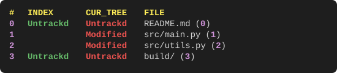
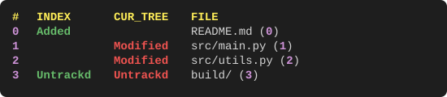
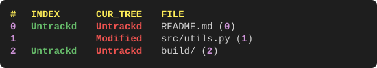
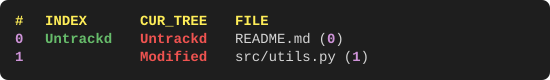
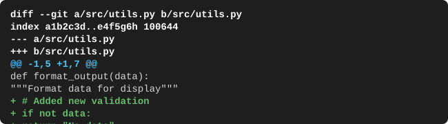

# gst [![MIT License][license-badge]](LICENSE.md) [![Tests][tests-badge]][tests-url] [![Coverage][coverage-badge]][coverage-url]

## Synposis
gst is short for **G**it **St**atus - it's a commandline app with some neat features for improving your workflow with git
Note that gst is meant for in dark themed terminals

## Installation
Install from pip.
```
pip install gst
```

## Usage

Here's a complete workflow demonstration showing how gst commands change your git status:

### 1. View repository status
Start by checking the current state of your repository:
```bash
$ gst
```


### 2. Get file path by reference
Use file index to get the exact path (great for piping to other commands):
```bash
$ gst 1
```


```bash
$ cat $(gst 1)    # Display contents of file at index 1
$ vim $(gst 1)    # Open file at index 1 in vim
```

### 3. Add files to staging area
Stage the untracked README.md file:
```bash
$ gst -a 0
```


Notice how README.md is now "Added" in the INDEX column, ready for commit.

### 4. Reset staged changes
Remove the file from staging area:
```bash
$ gst -r 0
```


The file is back to "Untrackd" status - no longer staged for commit.

### 5. Checkout files to revert changes
Revert working tree changes for src/main.py:
```bash
$ gst -c 1
```


The modified src/main.py has been reverted - notice it's no longer in the list.

### 6. Delete untracked files
Remove the untracked build/ directory:
```bash
$ gst -D 2
```


The build/ directory has been completely removed from the filesystem.

### 7. View file differences
See what changes remain in src/utils.py:
```bash
$ gst -d 1
```


### 8. Open file in editor
Edit the remaining modified file:
```bash
$ gst -e 1        # Opens src/utils.py in your default editor
```

### Range and selection syntax
All commands that accept `REF_RANGE` support flexible selection patterns:

| Pattern | Description | Example |
|---------|-------------|---------|
| `0,2,4` | Specific indices | `gst -a 0,2,4` |
| `1:3` | Range (inclusive) | `gst -r 1:3` |
| `2:` | Unbounded range | `gst -c 2:` |
| `0,2:4,6` | Mixed patterns | `gst -D 0,2:4,6` |

## Development Setup
To contribute to this project:

1. Clone the repository
2. Run the development setup script:
   ```bash
   ./scripts/setup_dev.sh
   ```

This script installs development dependencies (ruff, mypy, pytest, build, twine, pytest) and sets up a pre-commit hook that automatically runs:
- Code formatting (ruff format)
- Linting (ruff check)
- Type checking (mypy)
- Unit tests (pytest)

### Running tests
```bash
pytest tests/                    # Run all tests
pytest tests/test_gst.py -v      # Run specific test file with verbose output
```

### Regenerating README images
```bash
python scripts/generate_svg_examples.py
```

## Compatibility
- Linux, Mac, Windows
- Git version >=2
- Python 3.8+ (fully tested and supported)
- Python 3.6, 3.7 (best-effort support with manual testing)

### Python Version Support Policy
- **Python 3.8+**: Fully supported with automated testing in CI/CD
- **Python 3.6, 3.7**: Best-effort support with periodic manual testing for compatibility

Due to [GitHub Actions dropping support for Python 3.6 and 3.7](https://github.com/actions/runner-images/issues/10893), we can no longer provide automated testing for these versions. However, we will continue to maintain compatibility when possible and provide periodic updates with manual testing to confirm functionality.

## License MIT
[View project License](LICENSE.md).

[license-badge]: https://img.shields.io/badge/license-MIT-007EC7.svg
[tests-badge]: https://github.com/cpagravel/gst-python/workflows/Tests/badge.svg
[tests-url]: https://github.com/cpagravel/gst-python/actions/workflows/test.yml
[coverage-badge]: https://codecov.io/gh/cpagravel/gst-python/branch/master/graph/badge.svg
[coverage-url]: https://codecov.io/gh/cpagravel/gst-python
